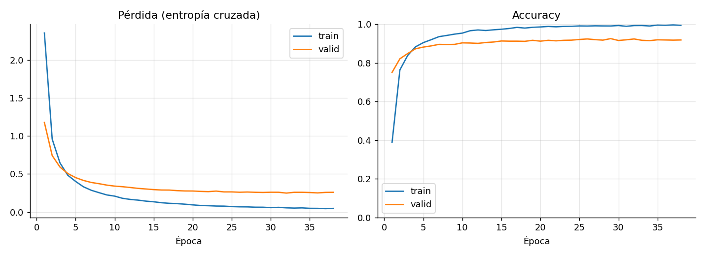

# AgroVision: diagnóstico de enfermedades en hojas de cultivos

Proyecto de la materia Inteligencia Artificial. Un modelo de visión por computadora recibe la foto de una hoja y estima el cultivo y la enfermedad entre **38 clases** (14 cultivos, hojas sanas y enfermas) del dataset PlantVillage.

> **Estado: modelo base (v0.1).** Sirve para validar que los datos y el flujo completo funcionan: preparación de datos, entrenamiento, evaluación, exportación y despliegue. Las siguientes versiones comparan más arquitecturas y usan el dataset completo.

## Resultados del modelo base

| Métrica | Valor |
| --- | --- |
| Accuracy en validación (1.140 imágenes, 30 por clase) | **92,4 %** |
| F1 macro en validación | 92,4 % |
| Top-3 accuracy en validación | 98,9 % |
| Accuracy en la carpeta `test` de Kaggle (33 imágenes) | 84,8 % (28/33) |
| Tamaño del modelo desplegado (TFLite cuantizado) | 2,6 MB |

- **Clases más difíciles:** Tomate · Mancha por Septoria (F1 0,67), Tomate · Mancha diana (0,75) y Tomate · Tizón temprano (0,78). Se confunden entre sí porque sus lesiones se parecen.
- **Errores en test:** 3 de los 5 son confusiones entre enfermedades del mismo cultivo (tizón temprano vs. tardío en papa y tomate).
- **Sobreajuste:** accuracy de entrenamiento 99 % frente a 92 % en validación; esperable con solo 100 imágenes por clase.



La matriz de confusión completa está en [`reports/v0.1/confusion_matrix.png`](reports/v0.1/confusion_matrix.png) y el detalle por clase en [`reports/v0.1/classification_report.json`](reports/v0.1/classification_report.json).

## Dataset

[New Plant Diseases Dataset (Kaggle)](https://www.kaggle.com/datasets/vipoooool/new-plant-diseases-dataset): versión aumentada de PlantVillage con ~70.300 imágenes de entrenamiento y ~17.600 de validación, a 256×256 px, en 38 clases. Incluye además una carpeta `test` con 33 imágenes sin subcarpetas (la clase va en el nombre del archivo).

Notas sobre el zip de Kaggle (`archive.zip`, 2,9 GB):

- **Trae el dataset duplicado** en dos carpetas (`New Plant Diseases Dataset(Augmented)` y `new plant diseases dataset(augmented)`). Por eso tarda tanto en descomprimir; basta con una copia.
- La carpeta `test` **no sirve para entrenar ni para evaluar en serio**: tiene solo 33 imágenes de 8 clases. Se usa como prueba rápida.
- Es una versión **aumentada**: las imágenes de validación pueden ser variaciones de imágenes de entrenamiento, así que la accuracy de validación puede ser optimista.

Los datos no se suben a este repositorio.

## Metodología del modelo base

1. **Muestra balanceada:** `scripts/extract_subset.py` lee el zip sin descomprimirlo y extrae 100 imágenes por clase para train y 30 para validación (semilla 42). Total: 3.800 + 1.140 imágenes, en unos minutos en vez de los ~40 que tarda descomprimir todo.
2. **Verificación:** `scripts/verify_subset.py` abre cada imagen y reescribe desde el zip las que estén dañadas.
3. **Transfer learning con extractor congelado:** MobileNetV2 preentrenado en ImageNet (sin la capa de clasificación) convierte cada imagen de 224×224 en un vector de 1.280 características. Esos vectores se calculan una sola vez y se guardan en caché.
4. **Cabeza de clasificación:** Dropout (0,3) + Dense softmax de 38 salidas, entrenada con Adam (lr 1e-3), lote 64 y early stopping (paciencia 6) sobre la pérdida de validación. Se detuvo en la época 38.
5. **Exportación:** se une la base y la cabeza en un solo modelo (`.keras`) y se convierte a TensorFlow Lite con cuantización dinámica para desplegar sin TensorFlow.

Todo corre en CPU: el modelo base se entrenó en un portátil sin GPU en unos 4 minutos.

## Estructura del repositorio

```
agrovision/
├── config/                 # proyecto Django: settings, urls, wsgi
├── diagnostico/            # app Django
│   ├── predictor.py        # carga el modelo TFLite y predice
│   ├── views.py            # formulario, predicción y datos de las gráficas
│   ├── templates/diagnostico/index.html
│   └── static/diagnostico/vendor/chart.umd.min.js   # Chart.js 4.4.1 (MIT)
├── models/
│   ├── agrovision.tflite           # modelo desplegado (lo genera scripts/export_tflite.py)
│   └── labels.json                 # orden de las 38 clases
├── reports/                # v0.1/ modelo base · <ID>/ cada experimento · app/ lo que muestra la página
├── scripts/                # preparación de datos, entrenamiento y gráficas
├── manage.py
├── requirements.txt        # dependencias de la app web (Render)
├── requirements-train.txt  # dependencias para entrenar
└── render.yaml             # configuración de despliegue
```

## Cómo reproducir

```bash
python -m venv .venv
# Windows: .venv\Scripts\activate   |   Linux/Mac: source .venv/bin/activate
pip install -r requirements-train.txt

python scripts/extract_subset.py --zip RUTA/archive.zip --out data/subset --train 100 --valid 30
python scripts/verify_subset.py  --zip RUTA/archive.zip --data data/subset
python scripts/train_baseline.py --data data/subset     # descarga los pesos de ImageNet la primera vez
python scripts/make_plots.py
```

## Entrenamiento completo (v0.2 en adelante)

Se entrena en WSL2 (Ubuntu) con la GPU; TensorFlow no usa la GPU en Windows nativo desde la versión 2.11.

**División de los datos.** `data/splits.csv` divide las 87.867 imágenes de `train` y `valid` en 80 % entrenamiento, 10 % validación y 10 % prueba. La división se hace por **foto original**: el dataset trae hasta 6 variaciones de cada foto (espejos y rotaciones), y en la división original de Kaggle el 60,6 % de `valid` son variaciones de fotos de `train`, lo que infla la precisión. Con esta división ninguna foto original queda en dos conjuntos. Se regenera con:

```bash
python scripts/make_split.py --zip ~/archive.zip
```

**Experimentos** (todos con las 38 clases):

| ID | Modelo | Estrategia |
| --- | --- | --- |
| E1 | CNN propia | Desde cero |
| C1, C2 | ResNet50 | Base congelada con 100 y 500 imágenes por clase (curva de aprendizaje) |
| E2 | ResNet50 | Base congelada, todas las imágenes |
| E3 | ResNet50 | Fine-tuning del bloque conv5 con Adam |
| E4 | ResNet50 | Fine-tuning del bloque conv5 con SGD con momentum |
| E5 | MobileNetV2 | Base congelada y luego fine-tuning |

```bash
source ~/venv/bin/activate
bash scripts/run_all.sh smoke   # prueba de humo: 1 época con el 5 % de los datos
bash scripts/run_all.sh         # todos los experimentos (varias horas)
bash scripts/run_all.sh E2 E3   # solo algunos
```

Cada corrida guarda sus métricas, curvas, matriz de confusión y errores en `reports/<ID>/`, y el modelo en `models/runs/<ID>/` (no se sube al repo). `scripts/compare.py` arma la tabla comparativa y la curva de aprendizaje en `reports/`.

### Evaluación final y despliegue del ganador

Cuando terminan todos los entrenamientos, se evalúa cada modelo **una sola vez** en el test (8.834 imágenes que ningún modelo vio), en la carpeta `test` de Kaggle y en 236 fotos de campo de [PlantDoc](https://github.com/pratikkayal/PlantDoc-Dataset). Las fotos de PlantDoc no se usan para entrenar: solo miden cuánto cae el modelo fuera del laboratorio.

```bash
# PlantDoc, solo la carpeta test (unos 70 MB), una vez
git clone --depth 1 --filter=blob:none --sparse https://github.com/pratikkayal/PlantDoc-Dataset ~/data/plantdoc
(cd ~/data/plantdoc && git sparse-checkout set test)

DATA="$HOME/data/New Plant Diseases Dataset(Augmented)/New Plant Diseases Dataset(Augmented)"
python scripts/evaluate.py --data-root "$DATA" --kaggle-test ~/data/test/test --plantdoc ~/data/plantdoc/test
python scripts/export_tflite.py --data-root "$DATA"
```

`evaluate.py` deja la tabla en `reports/evaluacion_final.md` y el ganador en `reports/ganador.txt` (mayor F1 en test; si otro queda a menos de 1 punto y pesa menos, gana el liviano). `export_tflite.py` convierte el ganador a TFLite, verifica que no pierda más de 1 punto de accuracy y actualiza `models/agrovision.tflite` y `reports/app/`, que es lo que muestra la página.

## Ejecutar la aplicación web localmente

```bash
pip install -r requirements.txt
python manage.py runserver
```

Abrir http://127.0.0.1:8000 y subir la foto de una hoja. La página muestra:

1. El diagnóstico y una **gráfica de barras con las 3 clases más probables**.
2. Las **curvas de pérdida y accuracy** por época del entrenamiento.
3. La **matriz de confusión** del modelo desplegado.

Si la clase más probable queda por debajo de 50 % de confianza, la página no da un diagnóstico seguro y pide otra foto.

`/health/` responde el estado del servicio. La aplicación no usa base de datos.

## Despliegue en Render

1. Subir el repositorio a GitHub.
2. En Render: **New → Blueprint**, elegir el repositorio. Render lee `render.yaml`, instala dependencias, ejecuta `collectstatic` y arranca con `gunicorn`.
3. Render genera `SECRET_KEY`, pone `DEBUG=False` y agrega su dominio a `ALLOWED_HOSTS` automáticamente.

El modelo se sirve con `ai-edge-litert` (runtime de TFLite) en lugar de TensorFlow completo, para caber en los 512 MB de RAM del plan gratuito. En ese plan el servicio se duerme tras 15 minutos sin uso y la primera visita tarda 30–60 s: abrirlo un rato antes de la sustentación.

## Próximas versiones

- [ ] Entrenar con el dataset completo en Google Colab (GPU T4).
- [ ] Comparar una CNN propia desde cero, MobileNetV2, EfficientNet-B0 y ResNet50 con fine-tuning.
- [ ] Eliminar casi-duplicados entre train y validación (hash perceptual) para medir sin fuga de datos.
- [ ] Mapas Grad-CAM en la demo.
- [ ] Probar con 30–50 fotos propias tomadas en campo.

## Licencia y créditos

Dataset: New Plant Diseases Dataset (Kaggle), derivado de PlantVillage (Hughes y Salathé, 2015). Pesos de MobileNetV2 entrenados en ImageNet.
